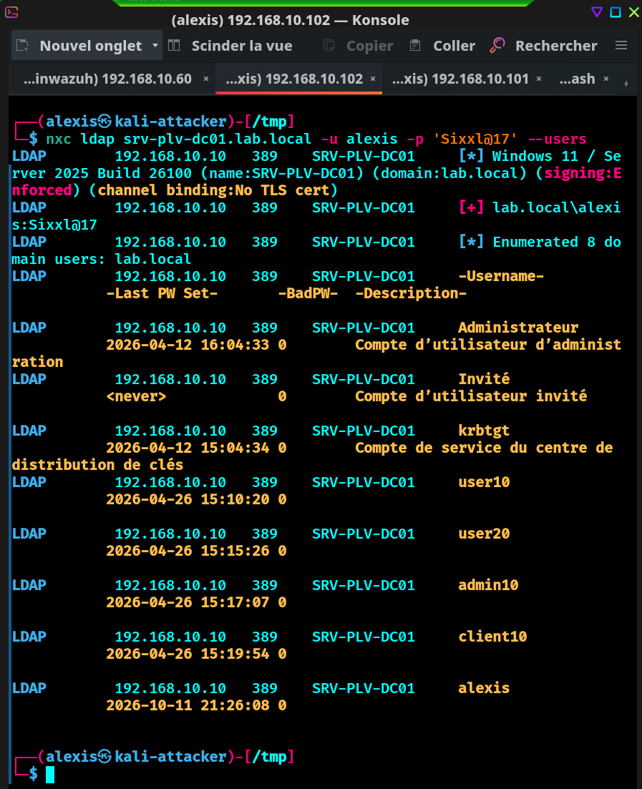
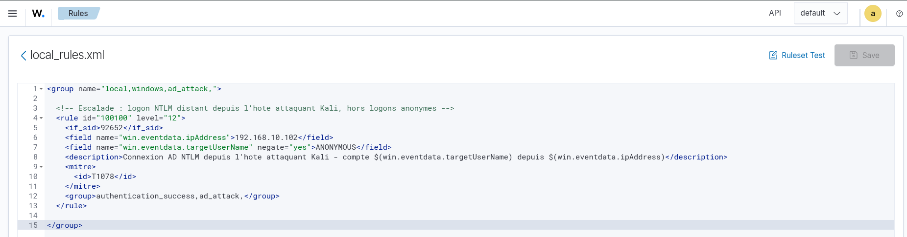
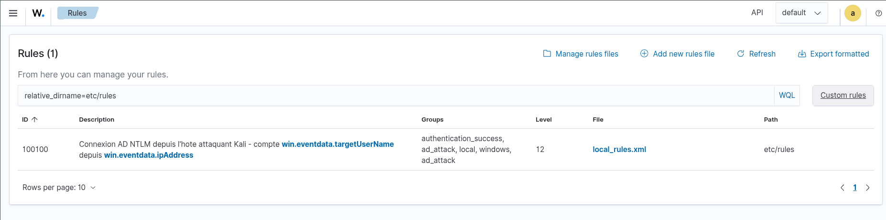
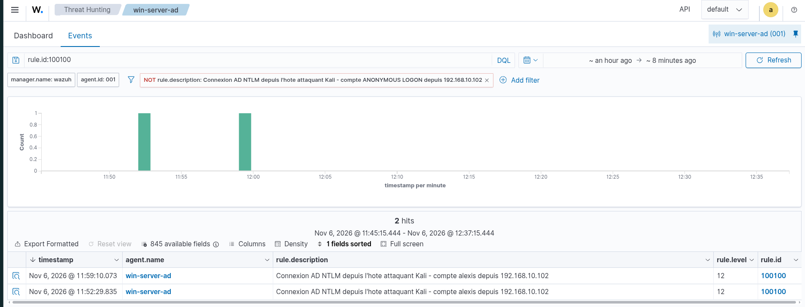

# Projet 2 — Purple Team Active Directory

> Deuxième maillon du homelab SOC & Purple Team : jouer des attaques AD
> réalistes depuis Kali, observer leur trace dans Wazuh, puis écrire et
> valider les règles de détection associées. Chaque technique suit la même
> boucle et est mappée sur MITRE ATT&CK.

**Statut :** en cours — 1 technique couverte de bout en bout, 1 règle custom validée.

---

## 1. Objectif

Démontrer la boucle purple team complète sur un Active Directory
(`lab.local`, DC `SRV-PLV-DC01` / 192.168.10.10) :

**attaquer (red) → observer (blue) → détecter → améliorer → rejouer → confirmer.**

Le SIEM et la télémétrie sont ceux du [Projet 1](../projet1-siem-wazuh/)
(Wazuh + Sysmon). Le détail des exercices, techniques et règles vit dans
[`journal-detection.md`](./journal-detection.md).

---

## 2. Méthodologie

Pour chaque technique :

1. **Red** — lancer l'attaque depuis Kali.
2. **Blue** — retrouver l'événement généré dans Wazuh (Threat Hunting),
   lire les champs clés (`eventID`, `logonType`, `ipAddress`…).
3. **Détecter** — vérifier si une règle existante matche ; sinon, écrire
   une règle custom (`local_rules.xml`).
4. **Rejouer** — relancer l'attaque (les règles Wazuh ne sont pas
   rétroactives) et confirmer le déclenchement.
5. **Documenter** — consigner dans le journal, mapper MITRE ATT&CK.

---

## 3. Exercices réalisés

| Date | Technique | MITRE | Détecté | Règle |
|------|-----------|-------|---------|-------|
| 2026-10-11 | Énumération AD via compte lambda | T1087.002 | ✅ | Règles Wazuh par défaut |
| 2026-11-06 | Logon NTLM distant depuis l'hôte attaquant | T1078 | ✅ | **Règle custom `100100`** |

Journal complet et notes d'exercice : [`journal-detection.md`](./journal-detection.md).

### Exercice marquant — énumération sur DC durci

Le collecteur `bloodhound-python` échoue car le DC impose le **LDAP signing
(Enforced)** sans LDAPS : le bind NTLM non signé est refusé. Contournement
via **NetExec** (`nxc ldap`) qui négocie le *sign & seal* SASL sur le port
389. Enseignement défensif : le LDAP signing est une **mitigation réelle**
qui force l'attaquant vers un canal signé et modifie la trace laissée — pas
juste « l'attaque marche ».

L'attaque depuis Kali — on voit `signing:Enforced`, l'authentification
`[+] lab.local\alexis` et l'énumération des comptes du domaine :



---

## 4. Règle de détection custom

Fichier : [`local_rules.xml`](./local_rules.xml) (déployé sur le manager
dans `/var/ossec/etc/rules/local_rules.xml`).

```xml
<rule id="100100" level="12">
  <if_sid>92652</if_sid>
  <field name="win.eventdata.ipAddress">192.168.10.102</field>
  <field name="win.eventdata.targetUserName" negate="yes">ANONYMOUS</field>
  <description>Connexion AD NTLM depuis l'hote attaquant Kali - compte $(win.eventdata.targetUserName) depuis $(win.eventdata.ipAddress)</description>
  <mitre><id>T1078</id></mitre>
</rule>
```

**Logique :** la règle Wazuh de base `92652` détecte un logon distant NTLM
(« possible pass-the-hash », niveau 6). Cette règle l'**escalade au niveau
12** quand la source est l'IP de l'hôte d'attaque (threat intel maison), et
exclut les `ANONYMOUS LOGON` (bruit du null bind) via `negate`.

La règle, écrite dans l'éditeur du dashboard (`etc/rules/local_rules.xml`) :



Elle apparaît ensuite dans la liste des règles custom du manager :



**Validation en live** : après rejeu de l'attaque, l'alerte `rule.id:100100`
remonte en **niveau 12** avec sa description dynamique
(`...compte alexis depuis 192.168.10.102`), hors logons anonymes :



---

## 5. Lessons learned

- **Les règles Wazuh ne sont pas rétroactives** — regénérer l'événement
  après création/modification de la règle pour la voir se déclencher.
- **Toujours lire le `rule.id` réel** de l'événement avant de choisir
  `<if_sid>` : la règle parente supposée (`60106`) était fausse, la bonne
  était `92652`, trouvée en inspectant l'event dans le dashboard.
- **Affiner pour réduire le bruit** : la 1ʳᵉ version captait aussi un
  `ANONYMOUS LOGON` ; ajout d'un `<field negate>` pour ne garder que les
  vrais comptes. Qualité de détection = moins de faux positifs.

---

## 6. Couverture MITRE ATT&CK

| Tactique | Techniques testées | Détectées |
|----------|--------------------|-----------|
| Reconnaissance / Discovery | 1 (T1087.002) | 1 |
| Lateral Movement | 1 (T1078) | 1 |
| Credential Access | 0 | 0 |
| Persistence | 0 | 0 |

---

## 7. Prochaines étapes

- [ ] **Kerberoasting** (T1558.003) — `GetUserSPNs.py`, détection sur Event 4769.
- [ ] AS-REP roasting (T1558.004).
- [ ] Pass-the-hash (T1550.002).
- [ ] BloodHound CE (neo4j + GUI) pour le graphe visuel.
- [ ] Tableau de couverture MITRE étoffé.
